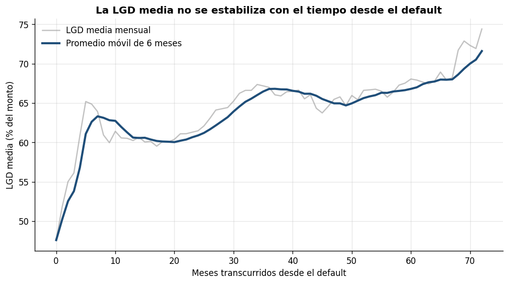
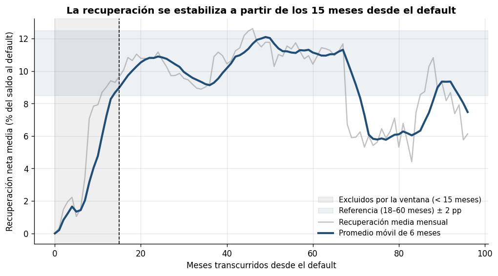
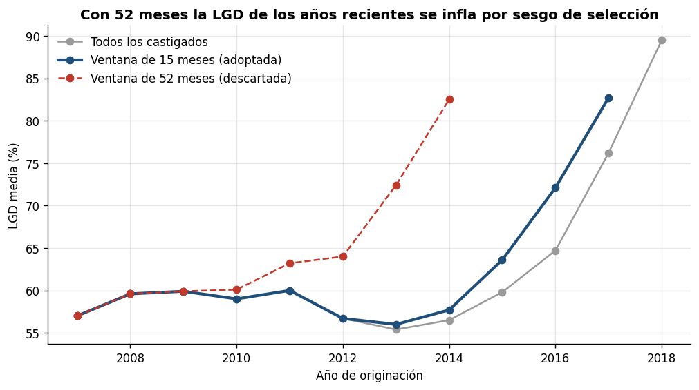

# Bitácora de Decisiones Analíticas

Registro de los percances y las decisiones del proyecto Análisis de la severidad de la pérdida (LGD) en los créditos en default de Happen Bank (LendingClub, 2007–2018). Cada registro indica qué pasó, cómo se detectó, qué se decidió, qué alternativas se descartaron y cómo afecta el resultado.

**Nota:** Los registros marcados como **posteriores al resultado** se hicieron después de evaluar el modelo en la base de prueba (2015) y no cambian el dictamen.

| N.º | Fecha                  | Etapa                                 | Percance o decisión                                                                                                                              | Cómo se detectó                                                                                    | Qué se hizo                                                                                                                                                                                                                                                    | Alternativas descartadas                                                                       | Efecto en el resultado                                                                                                                                                                                                                                                     |
|-----|------------------------|---------------------------------------|--------------------------------------------------------------------------------------------------------------------------------------------------|----------------------------------------------------------------------------------------------------|----------------------------------------------------------------------------------------------------------------------------------------------------------------------------------------------------------------------------------------------------------------|------------------------------------------------------------------------------------------------|----------------------------------------------------------------------------------------------------------------------------------------------------------------------------------------------------------------------------------------------------------------------------|
| 1   | 26 de octubre de 2026  | Datos                                 | La plataforma original de LendingClub (hoy Happen Bank) no permite descargar los datos históricos.                                               | Intentos de acceso, incluido el uso de una VPN.                                                    | Se usa la versión histórica publicada en Kaggle (George, 2019).                                                                                                                                                                                                | Plataforma de LendingClub.                                                                     | Los datos llegan hasta 2018 y no se pueden actualizar.                                                                                                                                                                                                                     |
| 2   | 6 de noviembre de 2026 | Datos                                 | El archivo se cargaba incompleto (5.602 filas) sin mostrar error, porque la opción `on_bad_lines``='``skip``'` saltaba las líneas dañadas.       | El número de filas no coincidía con el reportado en la descripción del conjunto (2.260.701).       | Se quitó la opción, la base se descarga directamente con `kagglehub` y se agregó un control que detiene el cuaderno si se cargan menos de 2 millones de filas.                                                                                                 | Seguir con el archivo descargado manualmente.                                                  | Todas las cifras se recalcularon; las de entregas anteriores no son comparables.                                                                                                                                                                                           |
| 3   | 6 de noviembre de 2026 | Datos                                 | Al final del archivo hay 33 filas de resumen que no son créditos.                                                                                | Su identificador no es un número.                                                                  | Se eliminan.                                                                                                                                                                                                                                                   | —                                                                                              | Ninguno sobre la población de castigados.                                                                                                                                                                                                                                  |
| 4   | 6 de noviembre de 2026 | Datos                                 | El identificador del prestatario (`member_id`) está vacío en toda la base.                                                                       | Revisión de faltantes.                                                                             | Se revisan duplicados por id del crédito (0) y por características idénticas (0); la partición se hace por tiempo.                                                                                                                                             | Partir por prestatario (A2-Paso 7.4).                                                          | La independencia entre prestatarios queda como limitación declarada.                                                                                                                                                                                                       |
| 5   | 6 de noviembre de 2026 | LGD                                   | La versión anterior del cálculo no restaba la comisión de cobranza a la recuperación e incluía los créditos en estado "Default".                 | Revisión del código contra la fórmula del A2-Paso 1.                                               | Se corrigió el cálculo y la población quedó en 269.320 castigados (sin los 40 "Default").                                                                                                                                                                      | Mantener los "Default", que aún no se castigan.                                                | La LGD del proyecto adapta el concepto de severidad de la pérdida de Basilea (Basel Committee on Banking Supervision, 2022, CRE 36) a los campos disponibles en la base: mide la pérdida realizada como proporción del monto desembolsado, neta de la comisión de cobranza |
| 6   | 7 de noviembre de 2026 | Censura                               | Los créditos castigados poco antes del cierre de la base no han terminado de recuperar, así que su LGD aparece inflada.                          | Retroalimentación del Avance 2.                                                                    | Ventana de maduración de 15 meses desde el default (excluye 72.917 créditos y deja 196.403). Detalle en el Anexo A.                                                                                                                                            | Curva de la LGD (dio N = 34, no se estabiliza); N = 52 con tolerancia de ±1 (excluía el 91 %). | Las conclusiones aplican a créditos con su recuperación completa.                                                                                                                                                                                                          |
| 7   | 7 de noviembre de 2026 | Censura                               | La base no trae la fecha de default.                                                                                                             | Revisión de las variables disponibles.                                                             | Se aproxima con la fecha del último pago y se contrasta con la fecha estimada por cuotas pagadas: diferencia de 6 meses o menos en el 99,4 % de los créditos. Una primera revisión reportó 99,9 % al medir la diferencia en una sola dirección, y se corrigió. | Fecha estimada por cuotas.                                                                     | Cambiar de fecha reclasifica 4.051 créditos (1,5 %); la población es prácticamente la misma.                                                                                                                                                                               |
| 8   | 7 de noviembre de 2026 | Partición                             | Las cohortes 2016 y 2017 quedan incompletas por la ventana (solo conservan los créditos que cayeron pronto en default) y 2018 sale por completo. | Tabla de créditos por año antes y después de la ventana.                                           | Se excluyen 2016–2017 del modelo; entrenamiento 2007–2014 (75.175) y prueba 2015 (64.846).                                                                                                                                                                     | Usar todas las cohortes, ponderar, controlar el momento del default.                           | El desempeño se sustenta para créditos originados hasta 2015.                                                                                                                                                                                                              |
| 9   | 7 de noviembre de 2026 | Partición                             | El A2-Paso 2.2 declaraba una partición aleatoria 70/15/15, que mezcla créditos con distinto nivel de recuperación.                               | Revisión de coherencia con el A2-Paso 4.                                                           | Partición temporal y validación cruzada con ventana expansiva en tres pliegues por año (validan 2012, 2013 y 2014).                                                                                                                                            | Partición aleatoria; partición automática por posición de las filas.                           | Siempre se predice el futuro con el pasado; la prueba se abre una sola vez.                                                                                                                                                                                                |
| 10  | 7 de noviembre de 2026 | Variables                             | La tasa de interés repite la información de la calificación.                                                                                     | Correlación de Spearman de 0,952 y VIF de 9,7.                                                     | Se excluye la tasa; las predictoras finales tienen un VIF máximo de 4,60.                                                                                                                                                                                      | Incluirla tal cual.                                                                            | No se reporta el efecto propio de la tasa.                                                                                                                                                                                                                                 |
| 11  | 7 de noviembre de 2026 | Variables                             | La utilización del crédito estaba entre las predictoras del A2-6.1.                                                                              | Correlación con la pérdida de −0,02 y pérdida casi igual entre quintiles (63,6 % a 65,5 %).        | Se retira del modelo.                                                                                                                                                                                                                                          | Incluirla (su VIF sería de 1,14, no se retira por multicolinealidad).                          | No se pierde información relevante.                                                                                                                                                                                                                                        |
| 12  | 7 de noviembre de 2026 | Atípicos                              | 13 créditos de calificación B a G tienen una tasa de 6 %, que no corresponde a su calificación.                                                  | Auditoría de atípicos.                                                                             | Se conservan, porque la tasa no entra al modelo.                                                                                                                                                                                                               | Excluirlos.                                                                                    | Ninguno.                                                                                                                                                                                                                                                                   |
| 13  | 7 de noviembre de 2026 | Atípicos                              | Hay ingresos de 0, relaciones deuda/ingreso vacías y mayores que 100.                                                                            | Revisión de valores imposibles.                                                                    | Se excluyen 39 créditos del ajuste (ninguno en entrenamiento, uno en prueba y 38 en 2016–2017).                                                                                                                                                                | Imputar valores.                                                                               | Efecto despreciable sobre el modelo.                                                                                                                                                                                                                                       |
| 14  | 7 de noviembre de 2026 | Variables                             | Varios propósitos tienen muy pocos créditos.                                                                                                     | Conteo por propósito.                                                                              | Se agrupan en "Otro" los propósitos con menos del 1 % del entrenamiento (siete propósitos), como indicaba el A2-Paso 3.                                                                                                                                        | Estimar cada propósito por separado.                                                           | Se evitan coeficientes inestables.                                                                                                                                                                                                                                         |
| 15  | 8 de noviembre de 2026 | Modelo                                | Las primeras iteraciones de Gibbs dependen del punto de arranque.                                                                                | Trazas de las cadenas.                                                                             | 4 cadenas que arrancan en puntos distintos, 6.000 iteraciones y se queman las primeras 1.000 de cada una; R-hat máximo de 1,0002.                                                                                                                              | Una sola cadena sin quemar.                                                                    | La posterior no depende del arranque.                                                                                                                                                                                                                                      |
| 16  | 8 de noviembre de 2026 | Resultados                            | El modelo no cumplió ninguno de los dos criterios: mejora del RMSE de 9,9 % (meta de 10 %) y captura de 39,2 % (meta de 40,9 %).                 | Evaluación en la prueba de 2015.                                                                   | Se reporta tal como salió, sin agregar variables ni probar versiones para cumplir (criterio de parada del Avance 2).                                                                                                                                           | Ajustar el modelo después de ver la prueba.                                                    | El veredicto se basa solo en el modelo principal.                                                                                                                                                                                                                          |
| 17  | 8 de noviembre de 2026 | Resultados (posterior al resultado)   | Pregunta sobre qué tan cerca quedó el modelo del 10 %.                                                                                           | Mejora de 9,9 %.                                                                                   | Análisis de incertidumbre con la posterior y con bootstrap: mejora entre 9,63 % y 10,16 %, con probabilidad de 23 % de alcanzar el 10 %.                                                                                                                       | —                                                                                              | Complementario; no cambia el veredicto.                                                                                                                                                                                                                                    |
| 18  | 8 de noviembre de 2026 | Resultados                            | La likelihood Normal no está acotada a \[0, 1\].                                                                                                 | Chequeo predictivo posterior: cobertura de 97,9 % y 3,4 % de pérdidas simuladas fuera de \[0, 1\]. | Se declara como limitación dentro del modelo propuesto.                                                                                                                                                                                                        | —                                                                                              | Los intervalos son algo conservadores.                                                                                                                                                                                                                                     |
| 19  | 8 de noviembre de 2026 | Exploratorio (posterior al resultado) | ¿Se pierde información al excluir la tasa?                                                                                                       | Relevancia económica de la tasa.                                                                   | Modelo con la tasa relativa a su calificación: mejora de 9,8 % y captura de 39,2 %.                                                                                                                                                                            | —                                                                                              | Confirma que la información de la tasa ya está en la calificación.                                                                                                                                                                                                         |
| 20  | 8 de noviembre de 2026 | Exploratorio (posterior al resultado) | ¿Mejora la priorización si se modela solo la recuperación?                                                                                       | Se evalúa como alternativa exploratoria, no modifica el dictamen .                                 | LGD = (1 − f) × (1 − r) con regresión bayesiana sobre r: mejora de −0,1 % frente a la línea base justa y captura de 40,6 %, igual al saldo.                                                                                                                    | —                                                                                              | No hay evidencia estadística suficiente para afirmar que alguna versión difiera del orden por saldo: la diferencia es de −0,00 puntos con LightGBM (intervalo del 95 % de −0,01 a +0,01) y de +0,01 con el modelo bayesiano sobre r (de −0,00 a +0,02).                    |
| 21  | 8 de noviembre de 2026 | Exploratorio (posterior al resultado) | ¿Mejora con más variables y un modelo no lineal?                                                                                                 | Se evalúa como alternativa exploratoria, no modifica el dictamen .                                 | Orden por saldo × (1 − recuperación predicha) con puntaje de crédito (FICO), antigüedad laboral, vivienda, verificación y LightGBM en dos partes: captura de 40,63 % frente a 40,64 % del saldo.                                                               | —                                                                                              |                                                                                                                                                                                                                                                                            |

---

# Anexo 1: Ventana de maduración de 15 meses

La LGD de un crédito castigado depende de lo que se recupera después del castigo, y esas recuperaciones llegan durante meses. Para un crédito que cayó en default poco antes de la última fecha reportada por George (2019), la cobranza todavía no ha terminado y la LGD aparece más alta de lo que realmente será, esto se declara como censura del target. La retroalimentación del Avance 2 sugirió la adopción de una ventana mínima de maduración: “solo entran los créditos con al menos N meses desde el default, declarando el N, por qué, y cuántos créditos se pierden.” (Pulido, 2026).

## El tiempo desde el default: Uso de última fecha de pago y comparativa con fecha estimada por cuotas pagadas.

La base no trae la fecha de default, así que se aproxima con la fecha del último pago (`last_pymnt_d`). Para los 2.325 créditos que nunca pagaron se usa la fecha de originación. La aproximación se contrastó con una fecha estimada por cuotas pagadas: coinciden en el mismo mes en el 64,4 % de los créditos, difieren en un mes o menos en el 88,8 % y en seis meses o menos en el 99,4 %. Para cada crédito se cuentan los meses entre su fecha de default y la fecha de corte.

**Alternativas realizadas para establecer N meses para la ventana.**

Con la finalidad de otorgar soporte técnico y robustez a los resultados finales, se revisan dos alternativas (descartada y adoptada, las dos debidamente justificadas).

## Primera alternativa, descartado: la curva de la LGD

Se buscó N sobre la LGD media según los meses desde el default, esperando que bajara hasta estabilizarse. No se estabiliza: empieza en 47 %, sube a cerca de 67 % hacia el mes 35 y vuelve a subir a 72 % hacia el mes 72. El único N encontrado (34 meses, con referencia de 36 meses) no tiene una interpretación válida. La razón es que la LGD mezcla lo que el cliente pagó antes del default, que se observa completo, con la recuperación posterior, que es lo único afectado por la censura (Ver Figura 1).

**Figura 1.** Curva de la LGD (Primer intento, descartado).

## Segundo intento, adoptado: la curva de recuperación

Como la censura solo afecta a las recuperaciones, N se midió sobre la tasa de recuperación neta: (recuperación − comisión) / saldo al default. Esta tasa se usa solo para elegir N, la fórmula de la LGD del proyecto no cambia (Ver Figura 2).

| Meses desde el default | Recuperación media         | Lectura                                                                               |
|------------------------|----------------------------|---------------------------------------------------------------------------------------|
| 0 a 6                  | Entre 0 % y 2 %            | Aún no se castiga o la cobranza no ha empezado                                        |
| 6 a 18                 | Sube de ~2 % a ~11 %       | La cobranza va recuperando                                                            |
| 18 a 65                | Estable entre ~9 % y ~12 % | Las recuperaciones ya terminaron: meseta                                              |
| Más de 66              | Cae a ~6 %                 | Defaults antiguos (antes de ~2013); un cambio en la cobranza de esa época, no censura |

## Elección de N = 15 y justificación.

N es el primer mes desde el cual el promedio móvil de 6 meses de la recuperación se mantiene dentro de una tolerancia alrededor de la recuperación de referencia, hasta el final del tramo. Se probaron 9 combinaciones de tramo de referencia y tolerancia:

| Tramo de referencia (meses) | Recuperación de referencia | Tolerancia | N (meses)      |
|-----------------------------|----------------------------|------------|----------------|
| 18–60                       | 10,6 %                     | ±0,5 pp    | No se encontró |
| 18–60                       | 10,6 %                     | ±1 pp      | 51             |
| 18–60                       | 10,6 %                     | ±2 pp      | 15             |
| 24–60                       | 10,4 %                     | ±0,5 pp    | No se encontró |
| 24–60                       | 10,4 %                     | ±1 pp      | 52             |
| 24–60                       | 10,4 %                     | ±2 pp      | 15             |
| 24–54                       | 10,4 %                     | ±0,5 pp    | No se encontró |
| 24–54                       | 10,4 %                     | ±1 pp      | 52             |
| 24–54                       | 10,4 %                     | ±2 pp      | 14             |

La regla fijada de antemano ("el N más frecuente; si hay empate, el mayor") dio un resultado bimodal y eligió 52 meses. Se descartó por dos razones:

1.  Excluía el 91 % de los créditos castigados.
2.  Creaba un sesgo de selección peor que el que quería corregir: de las cohortes de 2013–2014 solo quedaban los créditos que cayeron en default muy rápido, con una LGD artificialmente alta (73,1 % en 2013 y 83,0 % en 2014, frente a 55,4 % y 56,5 % con todos los castigados).

Se adoptó N = 15 meses: coincide con el punto en que la curva termina de subir (meses 15 a 18), es estable con tolerancia de ±2 pp en los tres tramos (14 a 15 meses), y esa tolerancia equivale a un margen de ±20 % sobre una recuperación de referencia de ~10,5 %, proporcional al ruido de la curva. Esta decisión se tomó después de ver la curva y antes de ajustar el modelo. (Ver Figura 3)

**Figura 2.** Curva de recuperación con N=15.

**Figura 3.** LGD por año con todos los castigados, con N=15 y con N=52.

## Efecto de la ventana de maduración sobre el conjunto de datos.

La ventana excluye 72.917 créditos (27,1 % de los castigados) y deja 196.403 para el análisis.

| Año de originación | Castigados | Después de la ventana | % que queda |
|--------------------|------------|-----------------------|-------------|
| 2007               | 158        | 158                   | 100,0       |
| 2008               | 496        | 496                   | 100,0       |
| 2009               | 723        | 723                   | 100,0       |
| 2010               | 1.757      | 1.757                 | 100,0       |
| 2011               | 3.297      | 3.297                 | 100,0       |
| 2012               | 8.644      | 8.641                 | 100,0       |
| 2013               | 21.024     | 20.746                | 98,7        |
| 2014               | 41.161     | 39.357                | 95,6        |
| 2015               | 75.803     | 64.847                | 85,5        |
| 2016               | 68.242     | 46.028                | 67,4        |
| 2017               | 39.148     | 10.353                | 26,4        |
| 2018               | 8.867      | 0                     | 0,0         |
| Total              | 269.320    | 196.403               | 72,9        |

## Lo que no hace la ventana de maduración.

De las cohortes recientes solo se observan, a marzo de 2019, los créditos que dejaron de pagar pronto (un crédito de 2017 castigado había pagado en promedio unas 4 cuotas, frente a 18–19 en 2012–2014). Los que caerán después todavía no aparecen en la base. Esta segunda censura (cohortes incompletas) no la corrige la ventana; por eso 2016 y 2017 no se usan para ajustar ni evaluar el modelo, y 2018 queda fuera por completo. El modelo se entrena con 2007–2014 y se evalúa con 2015.
